# AWS Academy Learner Lab — 4 Project Roadmap

Kumpulan panduan praktik langkah-demi-langkah, kode aplikasi, dan otomatisasi untuk membangun 4 proyek arsitektur cloud AWS secara mandiri melalui AWS Management Console di lingkungan **AWS Academy Learner Lab (Region: us-east-1)**.

---

## Ringkasan 4 Fase Proyek

```mermaid
graph TD
  subgraph Fase 1: Static Website & CDN
    U1[User HTTPS] --> CF[Amazon CloudFront + OAC]
    CF --> S3[Amazon S3 Private Bucket]
  end

  subgraph Fase 2: Three-Tier Web App
    U2[User] --> IGW[Internet Gateway]
    IGW --> EC2_2[EC2 Web/App Tier]
    EC2_2 --> RDS_2[(RDS MySQL Private)]
  end

  subgraph Fase 3: High Availability & Scaling
    U3[User] --> ALB[Application Load Balancer Multi-AZ]
    ALB --> ASG[Auto Scaling Group EC2]
    ASG --> RDS_3[(RDS MySQL Sentral)]
    ASG -. CloudWatch Alarm .-> SNS[SNS Alert Email]
  end

  subgraph Fase 4: Serverless REST API & CI/CD
    U4[Client / Mobile] --> APIGW[HTTP API Gateway v2]
    APIGW --> Lambda[AWS Lambda Python 3.12]
    Lambda --> DDB[(Amazon DynamoDB On-Demand)]
    GH[GitHub Actions CI/CD] --> SAM[AWS SAM Build & Deploy]
    SAM -. IaC .-> APIGW
    SAM -. IaC .-> Lambda
    SAM -. IaC .-> DDB
  end
```

---

## Navigasi File Panduan Praktik Console

Setiap fase memiliki panduan harian (Hari 1 sampai Hari 7) lengkap dengan **Tujuan**, **Jalur Menu**, **Tabel Nilai Isian**, **Verifikasi**, **Jebakan Umum**, dan **Biaya/Risiko ⚠️**:

| Fase | Topik & Arsitektur | File Panduan Lengkap | Kode & Aset Terkait |
| :--- | :--- | :--- | :--- |
| **Fase 1** | **Static Website Portfolio & CDN** `User -> CloudFront (OAC) -> S3 (Private)` | [phase1-static-site/console-guide.md](file:///e:/2026/Materi/cloud%20computing/road_belajar/phase1-static-site/console-guide.md) | [index.html](file:///e:/2026/Materi/cloud%20computing/road_belajar/phase1-static-site/site/index.html) [style.css](file:///e:/2026/Materi/cloud%20computing/road_belajar/phase1-static-site/site/style.css) [error.html](file:///e:/2026/Materi/cloud%20computing/road_belajar/phase1-static-site/site/error.html) |
| **Fase 2** | **Three-Tier Scalable Web App** `User -> IGW -> EC2 (Public) -> RDS MySQL (Private)` | [phase2-three-tier/console-guide.md](file:///e:/2026/Materi/cloud%20computing/road_belajar/phase2-three-tier/console-guide.md) | [server.js](file:///e:/2026/Materi/cloud%20computing/road_belajar/phase2-three-tier/app/server.js) [user-data.sh](file:///e:/2026/Materi/cloud%20computing/road_belajar/phase2-three-tier/user-data.sh) [.env.example](file:///e:/2026/Materi/cloud%20computing/road_belajar/phase2-three-tier/.env.example) |
| **Fase 3** | **High Availability & Auto Scaling** `User -> ALB (2 AZ) -> ASG (Multi-AZ) -> RDS` | [phase3-ha-scaling/console-guide.md](file:///e:/2026/Materi/cloud%20computing/road_belajar/phase3-ha-scaling/console-guide.md) | [server.js (IMDSv2)](file:///e:/2026/Materi/cloud%20computing/road_belajar/phase3-ha-scaling/app/server.js) [user-data.sh](file:///e:/2026/Materi/cloud%20computing/road_belajar/phase3-ha-scaling/user-data.sh) [load-test-guide.md](file:///e:/2026/Materi/cloud%20computing/road_belajar/phase3-ha-scaling/load-test-guide.md) |
| **Fase 4** | **Serverless REST API & CI/CD** `Client -> API Gateway -> Lambda -> DynamoDB` | [phase4-serverless-cicd/console-guide.md](file:///e:/2026/Materi/cloud%20computing/road_belajar/phase4-serverless-cicd/console-guide.md) | [app.py](file:///e:/2026/Materi/cloud%20computing/road_belajar/phase4-serverless-cicd/src/app.py) [test_app.py](file:///e:/2026/Materi/cloud%20computing/road_belajar/phase4-serverless-cicd/tests/test_app.py) [template.yaml](file:///e:/2026/Materi/cloud%20computing/road_belajar/phase4-serverless-cicd/template.yaml) [deploy.yml](file:///e:/2026/Materi/cloud%20computing/road_belajar/.github/workflows/deploy.yml) |

---

## Aturan Lingkungan AWS Academy Learner Lab
- **Region**: Selalu gunakan `us-east-1` (N. Virginia).
- **IAM Role**: Dilarang membuat IAM Role/Policy baru; gunakan `LabRole` dan `LabInstanceProfile`.
- **EC2 Instance**: Gunakan tipe `t3.micro` dengan Key Pair `vockey`.
- **RDS**: Gunakan engine `MySQL` tipe `db.t3.micro` Single-AZ (Private Access: No).
- **Timer Sesi**: Sesi berdurasi 4 jam. Klik **End Lab** setiap selesai belajar untuk menghemat kredit $100.
